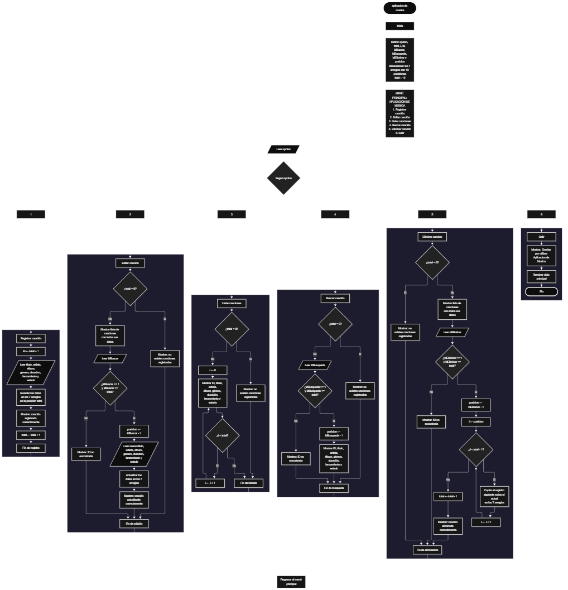

Este proyecto, llamado <b>aplicación de música</b>, fue desarrollado en <b>Java</b> como un ejercicio práctico para fortalecer la lógica de programación mediante la creación de un sistema de gestión de canciones desde la consola. El programa cuenta con un menú principal de seis opciones que permite <b>registrar, editar, listar, buscar y eliminar</b> las canciones almacenadas. Cada canción contiene información como el título, artista, álbum, género musical, duración, año de lanzamiento y estado de reproducción, utilizando arreglos con una capacidad de <b>10 canciones durante la ejecución</b>. Durante su desarrollo se aplicaron conceptos fundamentales de programación, como variables, arreglos, estructuras condicionales, ciclos repetitivos y estructuras de selección, además de procesos para buscar, modificar, eliminar y organizar registros. Este proyecto permite poner en práctica los conocimientos adquiridos en Java y sirve como base para desarrollar sistemas de gestión más avanzados utilizando otros lenguajes y tecnologías.

<h2 align="center">⚙️ Funcionamiento del menú principal</h2>

### ➕ Registrar canción

La opción <b>1) registrar canción</b> permite almacenar una nueva canción en la aplicación. Para realizar el registro, el programa genera un identificador mediante la operación <b>total + 1</b>, mostrando el ID correspondiente a la canción que se va a registrar. Después, solicita el <b>título, artista, álbum, género musical, duración, año de lanzamiento y estado de reproducción</b>. Los datos se almacenan en la posición correspondiente de sus respectivos arreglos. Finalmente, muestra el mensaje <b>"Cancion registrada correctamente."</b> y aumenta la variable <b>total</b> en uno para actualizar la cantidad de canciones registradas.

### ✏️ Editar canción

La opción <b>2) editar canción</b> permite modificar la información de una canción registrada. Primero, el programa comprueba si existen canciones almacenadas mediante la variable <b>total</b>. Si no hay registros, muestra el mensaje <b>"No existen canciones registradas."</b>. En caso contrario, presenta una lista con el ID, título, artista, álbum, género, duración, año de lanzamiento y estado de reproducción de cada canción. Después, solicita el ID de la canción que se desea editar y comprueba que se encuentre dentro del rango permitido mediante la condición <b>idBuscar &gt;= 1 y idBuscar &lt;= total</b>. Si la selección es válida, utiliza la variable <b>posicion</b> para localizar el registro y solicita nuevamente los siete datos de la canción, actualizando directamente los valores de los arreglos correspondientes. Finalmente, presenta el mensaje <b>"Cancion actualizada correctamente."</b>. Si el ID seleccionado no corresponde a una canción registrada, muestra el mensaje <b>"ID no encontrada."</b>.

### 📋 Listar canciones

La opción <b>3) listar canciones</b> permite visualizar todas las canciones registradas actualmente en la aplicación. Antes de mostrar la información, el programa comprueba si la variable <b>total</b> es igual a cero. Si no existen registros, presenta el mensaje <b>"No existen canciones registradas."</b>. Si hay canciones disponibles, utiliza un ciclo <b>for</b> para recorrer los arreglos desde la primera posición hasta el número total de canciones registradas. Durante el recorrido, muestra el ID, título, artista, álbum, género musical, duración, año de lanzamiento y estado de reproducción de cada canción. Esta función facilita consultar los registros existentes sin necesidad de buscar cada canción individualmente.

### 🔎 Buscar canción

La opción <b>4) buscar canción</b> permite localizar una canción mediante su ID. Primero, el programa comprueba si existen canciones registradas. Si la aplicación está vacía, muestra el mensaje <b>"No existen canciones registradas."</b>. En caso contrario, solicita el ID de la canción que se desea buscar y comprueba que esté dentro del rango permitido mediante la condición <b>idBusqueda &gt;= 1 y idBusqueda &lt;= total</b>. Si el ID es válido, utiliza la variable <b>posicion</b> para acceder a la información correspondiente y muestra el título, artista, álbum, género, duración, año de lanzamiento y estado de reproducción de la canción encontrada. Si el ID introducido no corresponde a ningún registro, presenta el mensaje <b>"ID no encontrada."</b>. La búsqueda se realiza directamente mediante el identificador de la canción.

### 🗑️ Eliminar canción

La opción <b>5) eliminar canción</b> permite eliminar una canción registrada mediante su ID. Antes de comenzar, el programa comprueba que existan canciones almacenadas. Si la aplicación está vacía, muestra el mensaje <b>"No existen canciones registradas."</b>. Si hay registros disponibles, presenta una lista con el ID y todos los datos de las canciones. Después, solicita el ID de la canción que se desea eliminar y verifica que esté dentro del rango válido. Si la canción existe, utiliza la variable <b>posicion</b> para identificar su ubicación y comienza el proceso de eliminación. Para mantener los registros organizados, utiliza un ciclo <b>for</b> controlado por la variable <b>i</b>, que desplaza una posición hacia la izquierda los datos de las canciones posteriores en los siete arreglos. Posteriormente, disminuye la variable <b>total</b> en uno y muestra el mensaje <b>"Cancion eliminada correctamente."</b>. Si el ID seleccionado no corresponde a una canción registrada, informa mediante el mensaje <b>"ID no encontrada."</b>.

### 🚪 Salir del menú principal

La opción <b>6) salir</b> está destinada a finalizar la ejecución de la aplicación y muestra el mensaje <b>"Gracias por utilizar Aplicacion de Musica."</b>. El menú principal se encuentra dentro de una estructura repetitiva <b>do-while</b>, que mantiene el programa en funcionamiento mientras se realizan las operaciones disponibles. La condición <b>opcion != 6</b> permite finalizar el ciclo cuando el usuario selecciona la opción 6. Finalmente, se utiliza <b>entrada.close()</b> para cerrar el objeto Scanner y terminar la ejecución del programa.

<h2 align="center">🧠 Temas aplicados en el proyecto</h2>

### 📦 Variables

En este proyecto se utilizan variables para guardar la opción seleccionada en el menú, controlar la cantidad de canciones registradas, recorrer los arreglos, identificar las canciones que se desean editar, buscar o eliminar y almacenar los identificadores utilizados en las diferentes operaciones. Cada variable cumple una función específica dentro de los procesos de gestión de canciones.

🔢 **Opcion:** Almacena la opción seleccionada por el usuario en el menú principal.

📊 **Total:** Almacena la cantidad actual de canciones registradas.

🔄 **I:** Funciona como contador en los ciclos <b>for</b> y permite recorrer los arreglos y reorganizar los registros durante la eliminación.

🆔 **Id:** Almacena el identificador generado para una nueva canción.

✏️ **IdBuscar:** Almacena el ID introducido por el usuario para seleccionar la canción que desea editar.

🔎 **IdBusqueda:** Almacena el ID utilizado para buscar una canción.

🗑️ **IdEliminar:** Almacena el ID de la canción que se desea eliminar.

📍 **Posicion:** Almacena la posición del arreglo correspondiente al ID seleccionado.

### 🗃️ Arreglos

En este proyecto se utilizan siete arreglos relacionados con la información de cada canción. Cada arreglo tiene una capacidad de <b>10 posiciones</b> y utiliza el mismo índice para representar los datos correspondientes a una misma canción. Por ejemplo, la información de una canción almacenada en la posición <b>0</b> se encuentra distribuida entre <b>titulos[0], artistas[0], albumes[0], generos[0], duraciones[0], lanzamientos[0] y estados[0]</b>. Esta organización permite recorrer, buscar, modificar, mostrar y eliminar canciones de manera ordenada.

🎵 **Titulos[10]:** Almacena los títulos de las canciones registradas.

🎤 **Artistas[10]:** Almacena los nombres de los artistas.

💿 **Albumes[10]:** Almacena los nombres de los álbumes musicales.

🎼 **Generos[10]:** Almacena los géneros musicales de las canciones.

⏱️ **Duraciones[10]:** Almacena la duración de cada canción.

📅 **Lanzamientos[10]:** Almacena los años de lanzamiento de las canciones.

▶️ **Estados[10]:** Almacena los estados de reproducción de las canciones.

### 🔀 Estructuras condicionales

En este proyecto se utilizan las estructuras <b>if</b> y <b>else</b> para comprobar si existen canciones registradas antes de realizar determinadas operaciones y verificar que el ID introducido por el usuario se encuentre dentro del rango permitido. Estas condiciones permiten que el programa responda de manera diferente según la cantidad de canciones almacenadas y el resultado de cada selección, evitando acceder a posiciones que no corresponden a registros existentes.

### 🔄 Estructuras repetitivas

En este proyecto se utilizan los ciclos <b>for</b> y <b>do-while</b>. Los ciclos <b>for</b> permiten recorrer los arreglos para mostrar las canciones registradas y acceder a sus datos. Durante la eliminación, también se utilizan para desplazar los datos de las canciones posteriores una posición hacia la izquierda. Por otro lado, el ciclo <b>do-while</b> mantiene activo el menú principal para que el usuario pueda ejecutar diferentes operaciones hasta seleccionar la opción de salida.

### 🎯 Estructura switch

El programa evalúa el valor almacenado en la variable <b>opcion</b> y ejecuta el bloque de instrucciones correspondiente mediante la estructura <b>switch</b>. Cada caso representa una operación específica de la aplicación: <b>registrar, editar, listar, buscar, eliminar o salir</b>. También se utiliza el bloque <b>default</b> para mostrar el mensaje <b>"Opcion no valida."</b> cuando el usuario introduce un número que no corresponde a ninguna de las opciones definidas en el menú.

### 🔢 Dimensionamiento de arreglos

En este proyecto se utiliza la instrucción <b>new</b> para crear los arreglos que almacenan la información de las canciones. Se definieron <b>10 posiciones</b> para cada uno de los siete arreglos, lo que permite almacenar hasta 10 canciones durante la ejecución. La cantidad de posiciones ocupadas se controla mediante la variable <b>total</b>, por lo que las operaciones recorren únicamente los registros comprendidos entre la primera posición y el total actual de canciones. El código no incluye una validación que impida superar la capacidad de los arreglos.

### 🔄 Reorganización de registros

Cuando se selecciona una canción para eliminarla, el programa utiliza un ciclo <b>for</b> que comienza en la posición seleccionada y llega hasta <b>total - 1</b>. En cada repetición, los datos de la posición siguiente se copian sobre la posición actual en los siete arreglos: <b>titulos, artistas, albumes, generos, duraciones, lanzamientos y estados</b>. Después, la variable <b>total</b> disminuye en uno. De esta manera, las canciones posteriores ocupan las posiciones disponibles sin dejar espacios vacíos entre los registros activos.

<h2 align="center">¿Cómo se implementaron las operaciones CRUD en el proyecto?</h2>

Las operaciones <b>CRUD</b> se implementaron mediante las opciones del menú principal, permitiendo administrar las canciones registradas. La operación <b>crear</b> corresponde a <b>registrar canción</b>, donde se introducen los datos de una nueva canción; <b>leer</b> se realiza mediante las opciones <b>buscar canción y listar canciones</b>; <b>actualizar</b> corresponde a <b>editar canción</b>, donde se modifican los datos de una canción registrada; y <b>eliminar</b> se realiza mediante la opción <b>eliminar canción</b>. Estas operaciones utilizan variables, arreglos, estructuras condicionales y ciclos para gestionar la información almacenada temporalmente durante la ejecución del programa.

<h2 align="center">Diagrama de flujo del proyecto</h2>

<h2 align="center">🛡️ Validaciones del programa</h2>

### 📭 No existen canciones registradas

Esta validación se utiliza en las opciones de <b>editar, buscar, listar y eliminar</b>. El programa comprueba si la variable <b>total</b> es igual a <b>0</b> y, si no existen canciones registradas, muestra el mensaje <b>"No existen canciones registradas."</b>. Esta comprobación evita continuar con las operaciones que necesitan información almacenada cuando la aplicación está vacía.

### ❌ ID no encontrada

Esta validación se utiliza durante las operaciones de <b>editar, buscar y eliminar canciones</b>. El programa comprueba que el ID introducido por el usuario sea mayor o igual a <b>1</b> y menor o igual al valor de <b>total</b>. Si el identificador se encuentra dentro del rango permitido, utiliza la variable <b>posicion</b> para acceder al registro correspondiente. En caso contrario, muestra el mensaje <b>"ID no encontrada."</b>, indicando que no existe una canción asociada con el identificador introducido.

### ⚠️ Capacidad de almacenamiento

Los siete arreglos del programa tienen una capacidad de <b>10 posiciones</b>, por lo que permiten almacenar hasta 10 canciones. Sin embargo, el código actual no incluye una condición que compruebe si la capacidad está completa antes de registrar una nueva canción. Si se intenta registrar una undécima canción, el programa intentará acceder a una posición fuera de los límites del arreglo y producirá un error <b>ArrayIndexOutOfBoundsException</b>. Por lo tanto, la capacidad está definida, pero todavía no cuenta con una validación para controlar los registros máximos.

### 🔢 Opción inválida

La estructura <b>switch</b> incluye el bloque <b>default</b>, que muestra el mensaje <b>"Opcion no valida."</b> cuando el usuario introduce un número que no corresponde a ninguna de las opciones definidas en el menú principal. Esta condición permite informar al usuario cuando selecciona una opción no disponible en la aplicación.

<h2 align="center">🎯 Objetivo del proyecto</h2>

El objetivo principal de este proyecto es fortalecer la <b>lógica de programación</b> mediante el desarrollo de un sistema de gestión de canciones en <b>Java</b>. A través de su construcción se busca aplicar los conocimientos adquiridos sobre variables, arreglos, estructuras condicionales, ciclos repetitivos y estructuras de selección, integrándolos para resolver un problema de manera organizada. Además, el proyecto permite comprender cómo registrar, consultar, modificar y eliminar información en una aplicación de consola, estableciendo una base para desarrollar sistemas de gestión más completos utilizando otros lenguajes y tecnologías.

